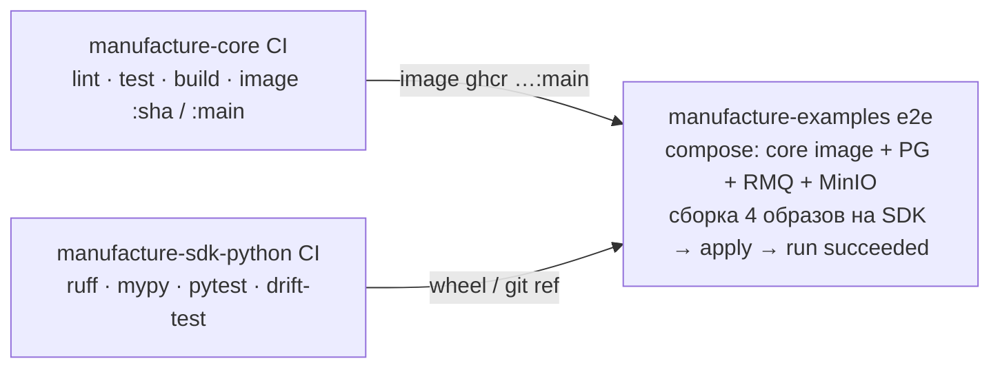
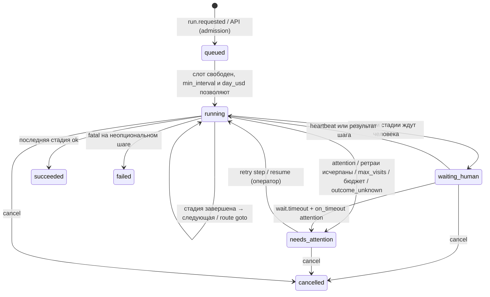
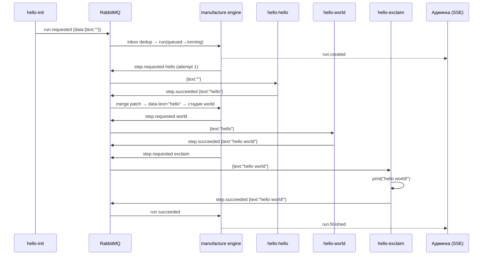

# Manufacture Core v2: архитектура универсального ядра конвейеров

Статус: **одобрено**, 10.11.2026 (ред. 2: отдельные репозитории).
Основа: v1-ядро `t1menar/manufacture` (тег `v1-legacy`, `f88ce1e`), PR #37 смержен, разбор `/workspace/manufacture-core-current-state.md` (32 проблемы, далее «П#N»).

---

## 0. Решения в одном экране

| # | Вопрос | Решение |
|---|---|---|
| D1 | Форма сервиса | **Один Go-бинарник `manufacture`** (модульный монолит) с ролями `engine`, `gateway`, `controller`. Локально все роли в одном процессе, в кластере их можно разнести по отдельным Deployment. admin-api вливается в роль `gateway`, админка встраивается в бинарник через `go:embed`. |
| D2 | Запуск модулей | **Подключаемый runtime-драйвер**: `docker` (локально, по умолчанию), `kubernetes` (прод, Deployment на модуль, реплики, HPA/KEDA), `external` (модуль запущен где угодно сам, например в IDE). |
| D3 | Модель пайплайна | Упорядоченные **стадии**. В стадии один шаг, несколько **параллельных** шагов или `foreach` (map по списку) с fan-in. Условия и переходы на CEL, ограниченные циклы (`max_visits`), retry с backoff, таймауты и lease. |
| D4 | Конфигурация | **Декларативный YAML-спек** (`apiVersion: manufacture.dev/v1`, виды `Module` и `Pipeline`). **Источник истины — БД ядра**, где хранятся неизменяемые ревизии. Применяется через `mfctl apply -f` или из UI, причём UI редактирует тот же YAML. |
| D5 | Транспорт | **Оставляем RabbitMQ** и прячем его за интерфейсом `Bus`. Модулю нужны только брокер и S3, входящая сеть до ядра ему не нужна. |
| D6 | Данные между модулями | **Контекст запуска** (JSON) плюс **claim-check**: всё, что больше 64 КиБ, SDK сам кладёт в S3/MinIO и передаёт ссылкой `$blob`. Слияние идёт через JSON Merge Patch с явными правилами для параллельных шагов. |
| D7 | SDK | Пакет `manufacture-sdk` для Python: `@app.step` и `@app.source`, Pydantic-схемы, автоматические heartbeat, метрики, трейсы и отмена. |
| D8 | Наблюдаемость | Обязательные метрики считает **ядро** (оно видит каждый переход шага), экспорт в Prometheus `/metrics`, трейсы OpenTelemetry. Живые данные идут в панель по **SSE**. |
| D9 | Админка | Остаётся React + TS + Vite + Mantine + TanStack. Для 3D добавляются three.js, `@react-three/fiber`, `drei` и `postprocessing`. Главный экран — 3D-конвейер. |
| D10 | Репозитории | **Три отдельных репозитория**: `manufacture-core` (Go и админка, владелец контракта), `manufacture-sdk-python`, `manufacture-examples`. Схемы контракта публикуются из core, SDK держит вендорную копию с drift-тестом, e2e живёт в examples (§1.2–1.4). Видео-модули остаются в `t1menar/manufacture/video-modules/`. |

---

## 1. Целевая архитектура

### 1.1 Компоненты

```mermaid
flowchart LR
  subgraph mf["manufacture (один бинарник)"]
    GW["gateway<br/>REST API · SSE · админка (embed)"]
    ENG["engine<br/>планировщик запусков, state machine,<br/>outbox relay, inbox, sweeper"]
    CTL["controller<br/>reconcile модулей → runtime-драйвер"]
    MET["metrics<br/>/metrics, OTel"]
  end
  PG[("PostgreSQL<br/>spec, runs, steps, events, outbox")]
  MQ{{"RabbitMQ<br/>mf.commands / mf.events"}}
  S3[("MinIO / S3<br/>blobs (claim-check)")]
  PROM["Prometheus"]
  RT["Runtime: Docker Engine API<br/>или Kubernetes API"]
  subgraph mods["Модули (Docker-образы, N реплик)"]
    M1["module A<br/>SDK"]
    M2["module B<br/>SDK"]
    M3["module C<br/>SDK"]
  end
  UI["Браузер: админка"] -- HTTPS + SSE --> GW
  CLI["mfctl"] -- REST --> GW
  GW --> PG
  ENG --> PG
  ENG -- outbox --> MQ
  MQ -- step.requested --> M1 & M2 & M3
  M1 & M2 & M3 -- step.* / run.requested --> MQ --> ENG
  M1 & M2 & M3 <--> S3
  CTL --> RT --> mods
  PROM -- scrape --> MET
  PROM -. scrape опц. .-> mods
  GW -. история графиков .-> PROM
```

| Компонент | Ответственность | Владеет данными |
|---|---|---|
| **engine** | Запуски (runs), шаги, переходы, ретраи, таймауты, lease, admission (лимиты параллельности), outbox/inbox | `runs`, `steps`, `step_attempts`, `context_snapshots`, `events`, `outbox`, `inbox`, `run_queue` |
| **controller** | Сверяет желаемое состояние модулей (spec) с фактическим (контейнеры или поды) через драйвер, следит за готовностью реплик | `module_status` |
| **gateway** | REST API (`/api/v1`), SSE-поток, `mfctl apply`, аутентификация, аудит, раздача админки, прокси PromQL | `pipeline_revisions`, `module_revisions`, `audit_log` |
| **metrics** | Prometheus-реестр, OTel-экспорт; общий для всех ролей | — |

**Почему не отдельные микросервисы.** У всех ролей одна БД и одна модель данных, а нагрузка измеряется единицами и десятками задач в минуту. Раздельные сервисы добавили бы сетевые контракты, отдельный деплой и согласование версий, но ничего не дали бы. Роли при этом изолированы на уровне пакетов и запускаются флагом `manufacture serve --roles=engine,controller`, поэтому разнести их по процессам можно без переписывания. Отдельный «сборщик метрик» тоже не нужен: эту работу делает Prometheus, а живые цифры панель получает из ядра.

**Чем отличается от v1.**
- admin-api больше нет как отдельного сервиса. Это был прокси, и его audit-журнал переезжает в БД ядра.
- Из ядра уходят видео-сущности: `productions/variants`, review rounds, publish intents, channels и routing, `idea.*`, prompts.
- Вместо них появляются общие **run → stage → step**.

### 1.2 Репозитории

Решение принято: **три отдельных публичных репозитория** (MIT). Старый `t1menar/manufacture` остаётся домом видео-модулей (`video-modules/`, PR #37 смержен), а v1-ядро сохранено тегом `v1-legacy` (`f88ce1e`). Видео-пайплайн на его `main` больше не поддерживается, пока модули не перенесут на SDK отдельной задачей.

| Репозиторий | Содержимое | Артефакты |
|---|---|---|
| [`manufacture-core`](https://github.com/t1menar/manufacture-core) | Go: engine, controller, gateway, `mfctl`; встроенная админка (`web/`); **владелец контракта** (`schemas/`, `api/openapi.yaml`); Helm и compose | образ `ghcr.io/t1menar/manufacture-core:<ver>`, бинарники `manufacture`/`mfctl`, `contract-v<ver>.tar.gz` (схемы) в GitHub Release |
| [`manufacture-sdk-python`](https://github.com/t1menar/manufacture-sdk-python) | пакет `manufacture` (SDK) и CLI `mf-module`; вендорная копия схем контракта | пакет на PyPI или в GitHub Release (wheel) |
| [`manufacture-examples`](https://github.com/t1menar/manufacture-examples) | `hello-world/` (4 модуля + `pipeline.yaml`), позже `geo/` и `video/` (скелеты); кросс-репозиторный e2e | образы примеров только в CI |

```
manufacture-core/
├── cmd/manufacture/       # serve | migrate | validate | config | version
├── cmd/mfctl/             # apply | get | describe | scale | delete | run | logs
├── internal/
│   ├── config/            # env-конфиг ядра
│   ├── spec/              # Go-типы ресурсов, декодер YAML, семантическая проверка
│   ├── spec/expr/         # компиляция CEL
│   ├── store/ engine/ bus/ runtime/ controller/ blob/ api/ auth/ telemetry/ itest/   # по плану
├── schemas/               # контракт: v1/module.schema.json, v1/pipeline.schema.json, envelope/v2/*.json, VERSION
├── api/openapi.yaml
├── web/                   # админка → embed
├── deploy/{compose,helm,kind}/
├── testdata/              # валидные и невалидные спеки (их же гоняет SDK)
└── docs/adr/

manufacture-sdk-python/
├── src/manufacture/{app,context,errors,blobs,transport,telemetry}/...
├── src/manufacture/_contract/   # вендорная копия schemas/ из core + CONTRACT_VERSION
├── tests/contract/              # drift-тест и прогон testdata/ из core
└── pyproject.toml (uv)

manufacture-examples/
├── hello-world/{pipeline.yaml, modules/{init,hello,world,exclaim}/}
├── e2e/{compose.yml, run.sh}
└── versions.env                 # CORE_IMAGE=..., SDK_VERSION=...
```

### 1.3 Как контракт версионируется и делится

- **Владелец контракта — `manufacture-core`**, директория `schemas/`:
  - JSON Schema ресурсов (`schemas/v1/*.schema.json`, `apiVersion: manufacture.dev/v1`);
  - конверт сообщений (`schemas/envelope/v2/*.json`);
  - манифест модуля.
  
  Go-код встраивает их через `go:embed` и валидирует ими. Схемы не дублируются руками в Go: у Go-типов есть тест, что все `testdata/valid/*` проходят и схему, и строгий декодер (`DisallowUnknownFields`), то есть схема и типы не расходятся.
- **Версии.**
  - Ресурсы версионируются через `apiVersion`. Совместимые изменения (новое необязательное поле) делаются внутри `v1`. Ломающие изменения означают `v2`, и ядро в переходный период принимает две версии.
  - Конверт версионируется через `schema_version`.
  - Весь пакет схем версионируется семвером в `schemas/VERSION` (сейчас `0.1.0`; до `1.0.0` допускаются ломающие изменения). Он совпадает с тегом релиза ядра или меньше него: схемы меняются реже кода.
- **Публикация.** На тег `vX.Y.Z` CI ядра прикладывает к релизу `contract-vX.Y.Z.tar.gz` и `SHA256SUMS`, а также пушит образ.
- **SDK.**
  - SDK хранит вендорную копию в `src/manufacture/_contract/` и `CONTRACT_VERSION`. Обновление — скрипт `make contract-sync VERSION=x.y.z`, оформленный отдельным PR.
  - **Drift-тест** в CI SDK скачивает архив пинованной версии из релиза ядра и сравнивает побайтно. Отдельная nightly-задача сравнивает с `main` ядра и только сообщает о расхождении, без падения PR.
  - Тот же тест прогоняет `testdata/valid` и `testdata/invalid` из ядра через Pydantic-модели SDK, так что SDK и ядро одинаково принимают и отвергают спеки.
- **Совместимость в рантайме.** Модуль сообщает `sdk_version` и `contract_version` в `module.online`. Ядро отклоняет несовместимую версию (другая мажорная, до 1.0.0 — другая минорная) с понятной ошибкой в UI: реплика `unhealthy`.

### 1.4 Кросс-репозиторный CI и e2e


- **examples**: e2e запускается на каждый PR, раз в сутки и вручную (`workflow_dispatch` с параметрами `core_image`, `sdk_ref`).
  - По умолчанию берутся `versions.env`: последний релиз core и SDK. Nightly прогоняет матрицу `{release, main} × {release, main}`.
  - Результат успешен, когда Hello World `succeeded`, в логах есть `hello world!` и выросла метрика.
- **core**: начиная с PR C6, на каждый PR публикует образ `:pr-<n>` и запускает job `e2e-examples`. Этот job клонирует `manufacture-examples@main` и `manufacture-sdk-python@main` и запускает тот же `e2e/run.sh` с образом PR. Ломающее изменение видно ещё до мержа.
- **SDK**: так же, job `e2e-examples` с образом `core:main` и SDK из PR.
- Автоматический запуск e2e в соседнем репозитории (`repository_dispatch`) потребовал бы PAT в секретах, поэтому он не нужен. Каждый репозиторий сам клонирует соседей, все они публичные.

---

## 2. Runtime: Kubernetes или Docker

### 2.1 Сравнение

| Критерий | Docker Engine API | Kubernetes | Только внешние модули |
|---|---|---|---|
| Порог входа локально | `docker compose up`, всё | kind/k3d, kubeconfig, registry | минимальный |
| Реплики и автоскейл | реплики вручную, без HPA | Deployment, HPA, KEDA по длине очереди | нет |
| Самовосстановление | `restart: unless-stopped` | probes, reschedule | нет |
| Секреты | env и файлы | Secret, ServiceAccount | свои |
| Риск безопасности | `docker.sock` = root на хосте | Role в namespace | нет |
| Где нужен | разработка, один сервер | прод, несколько узлов | отладка модуля в IDE |

**Решение: интерфейс `runtime.Driver` и три реализации.** Ядро не должно зависеть от Kubernetes: Hello World и разработка модулей должны работать от одной команды на ноутбуке. При этом прод-путь — Kubernetes, и проектировать нужно сразу под него: реплики, readiness, ресурсы, секреты.

```go
// internal/runtime
type Driver interface {
    Name() string
    // Apply приводит модуль к желаемому состоянию; идемпотентен.
    Apply(ctx context.Context, m ModuleDeployment) error
    Delete(ctx context.Context, name string) error
    Status(ctx context.Context, name string) (ModuleStatus, error) // desired/ready replicas, image, reasons
    Logs(ctx context.Context, name string, opt LogOptions) (io.ReadCloser, error)
}
type ModuleDeployment struct {
    Name, Image string            // image обязательно с digest в проде
    Replicas    Replicas          // {Min, Max} или фиксированное
    Concurrency int               // prefetch на реплику
    Env         map[string]string
    SecretRefs  []SecretRef
    Resources   Resources
    Revision    int64             // для меток и rollout
}
```

### 2.2 Как ядро разворачивает образ модуля

**Kubernetes-драйвер (client-go):**
- Один `Deployment` на модуль в namespace `mf-modules`, метки `manufacture.dev/module=<name>` и `manufacture.dev/revision=<n>`.
- `replicas` из спека. Если задан `autoscale`, создаётся HPA (CPU) или, лучше, KEDA `ScaledObject` по длине очереди `mf.module.<name>`: это честная метрика нагрузки для worker-модулей, и она позволяет масштабировать до 0.
- Секреты подключаются через `envFrom.secretRef`, имена Secret берутся из спека, значения в спек не попадают.
- Модулю не нужен Service, потому что входящего трафика у него нет. Probes: SDK отдаёт `/healthz` и `/readyz` на порту `8081` (ready значит, что есть подключение к брокеру).
- Rollout делает `RollingUpdate`. Старые реплики дорабатывают задачи по `terminationGracePeriodSeconds`, SDK по SIGTERM перестаёт брать новые сообщения.
- Ядро не пишет CRD и оператор: состояние уже лежит в БД, а оператор понадобится, только если захочется GitOps через `kubectl`. Это условие пересмотра.

**Docker-драйвер (Docker Engine API, `github.com/docker/docker/client`):**
- По контейнеру на реплику `mf-<module>-<i>` в сети `manufacture`, метки как в k8s. Healthcheck идёт через тот же `/healthz`.
- Масштабирование сводится к созданию или удалению контейнеров. Автоскейла нет, только фиксированное число реплик.

**External-драйвер:** ничего не запускает. Модуль просто подключается к брокеру со своими креденшелами, а статус реплик считается по heartbeat.

Controller — это цикл reconcile раз в 5 с плюс реакция на `apply`. Он берёт лидерство через advisory-lock (П#31) и пишет `module_status`, а изменения отправляет в SSE.

### 2.3 Локальная разработка
- `make up`: compose (`manufacture`, PG, RMQ, MinIO, Prometheus), драйвер `docker`. Админка открывается на `http://127.0.0.1:8080`.
- `make kind-up` (в `manufacture-core`): kind-кластер, локальный registry `localhost:5001`, `helm install manufacture deploy/helm/manufacture`, драйвер `kubernetes`. Это CI-проверка k8s-пути, e2e Hello World.
- Модуль в IDE: `MF_RUNTIME=external` в спеке модуля и `mf-module run` локально с теми же переменными окружения.

---

## 3. Модель пайплайна

### 3.1 Понятия
- **Module** — образ, обработчик и его схемы. Один модуль может использоваться в нескольких пайплайнах.
- **Pipeline** — граф стадий. Хранится ревизиями, каждая ревизия неизменяема.
- **Run** — один запуск пайплайна, жёстко привязанный к ревизии (снапшот, как `pipeline_snapshot` в v1).
- **Stage** — позиция на конвейере. Стадия завершена, когда завершены все её шаги (fan-in).
- **Step** — вызов модуля внутри стадии. **Attempt** — попытка шага с уникальным `attempt.id`; визит шага (заход в стадию) адресуется `step_key`, общим для всех его попыток (contract 0.3.0, `docs/messaging.md` §4.5).

### 3.2 Виды стадий
| Вид | YAML | Семантика |
|---|---|---|
| Один шаг | `step: {module: x}` | последовательное выполнение |
| Параллельные разные модули | `parallel: [{id: a, module: x}, {id: b, module: y}]` | все стартуют одновременно; `join.mode: all` (по умолчанию), `any`, `quorum: N` |
| Map по списку | `foreach: "data.tiles"`, `step: {module: x}`, `max_parallel: 8` | по шагу на элемент; результаты собираются в массив по индексу |
| Ожидание человека или сервиса | шаг с `wait: {timeout: 7d}` и `on_timeout: attention` (например review) | модуль шлёт `step.waiting`: lease и таймаут на паузе, run в `waiting_human`, слот `max_runs` не занят; ответ приходит позже из любой реплики (ADR-0014, `docs/patterns/review-gate.md`) |

### 3.3 Условия и переходы
- `when:` на шаге или стадии — CEL-выражение (`google/cel-go`, компилируется при apply). Если результат `false`, шаг получает статус `skipped`.
- `routes:` на стадии — список `{when, goto, max_visits}`. Первое истинное правило переносит run на указанную стадию. Так выражается цикл «ревью отклонено → доработка» без кода в ядре, а `max_visits` защищает от бесконечного цикла. При превышении run уходит в `needs_attention`.
- В CEL доступны `data` (общий контекст), `steps.<id>.output` (последний визит), `steps.<id>.visits[n]`, `steps.<id>.last`, `steps.<id>.visit`, `visit` (номер текущего визита стадии), `run.trigger`, `attempt` (§5.3a).
- `max_visits` считается на стадию-цель: суммарное число заходов в неё по всем правилам, ведущим туда. Правила с разными `max_visits` для одной цели — ошибка валидации; при превышении run уходит в `needs_attention` (`max_visits_exceeded`).

### 3.4 Надёжность шага
```yaml
retry:   {max_attempts: 3, backoff: exponential, initial: 2s, max: 5m, jitter: true, on_errors: [transient, timeout, lost]}  # это и есть умолчания (действуют и без блока retry); не `on`: YAML 1.1 читает его как true
timeout: 30m      # (умолчание) бюджет исполнения: от первого heartbeat до результата, без времени в waiting
lease:   60s      # без heartbeat дольше lease → attempt lost → retry; по умолчанию min(60s, timeout/2), не меньше 3s
on_timeout: retry # retry | fail | attention; действует и на timeout, и на wait.timeout
```
- Классы ошибок из SDK: `transient` (ретрай), `fatal` (run `failed`, если стадия не `optional: true`), `attention` (run в `needs_attention`, оператор решает в UI).
- Следующая попытка ставится с `not_before` и backoff (П#10).
- Каждая попытка хранит **полный неизменяемый запрос**, поэтому retry, takeover и retry из UI отправляют тот же запрос с новым `attempt.id` (тот же `step_key`) (П#2–П#6 закрываются конструктивно).
- По таймауту или отмене ядро всегда отправляет `step.cancel` (П#8).
- Перед необратимым действием модуль вызывает `confirm` (ADR-0013). Подтверждённую попытку ядро никогда не ретраит автоматически: по `timeout` или `lost` после `confirmed_until` она уходит в `needs_attention` (`outcome_unknown`).

### 3.5 Лимиты и admission
- `pipeline.spec.concurrency.max_runs` ограничивает активные runs пайплайна, остальные ждут в `run_queue` (обобщение `pending_ideas`). Run в `needs_attention` и `waiting_human` **не занимает** слот: учитываются только `running` (П#1; `count_waiting: true` включает `waiting_human`).
- Очередь упорядочена по `priority DESC, enqueued_at` (`priority` −100..100 из `run.requested`, API или `spec.priority`); `concurrency.min_interval` задаёт минимальный интервал между стартами run пайплайна (`pipeline_admission.last_started_at`).
- Бюджет `spec.budget {run_usd, warn_usd, day_usd}` считается по `usage.cost_usd`, которое сообщают модули (цены у модулей). `run_usd` → отмена неподтверждённых попыток и `needs_attention` (`budget_exceeded`); `day_usd` → новые run ждут в очереди; `min_budget_usd` модуля или шага → шаг не отправляется при недостатке остатка.
- Модуль ограничивает нагрузку сам, через `concurrency` (prefetch) × реплики. Очередь в RabbitMQ и есть backpressure.

### 3.6 Версионирование
- `apply` с изменённым спеком создаёт новую ревизию (`revision`, `spec_hash`, `applied_by`, `source: cli|ui|bootstrap`). Повторный `apply` того же спека ничего не делает.
- Уже идущие runs продолжают на своей ревизии, новые берут текущую. Откат делается командой `mfctl rollout undo pipeline/x --to=3`, это новая ревизия с содержимым старой.
- Модули тоже версионируются. Шаг ссылается на модуль по имени, а ревизия модуля фиксируется в момент старта шага.

---

## 4. Конфигурация: один подход

| Вариант | Плюсы | Минусы |
|---|---|---|
| Только YAML-файлы, ядро читает директорию | Git, ревью, воспроизводимость | UI не может менять; при нескольких репликах нужна синхронизация файлов |
| Только UI, данные в БД | Удобно мышкой | Нет диффа и ревью, сложно перенести между средами, нет «инфраструктуры как кода» |
| CRD в Kubernetes | GitOps из коробки | Не работает без k8s, а локальный и Docker-режим обязательны |
| **YAML-спек как формат, БД как хранилище ревизий** | Одна модель для CLI, UI и Git; дифф и откат; работает везде | Нужно следить, кто хозяин: git или UI |

**Решение (D4).** Существует **один формат** — YAML/JSON-спек со схемой `api/spec.schema.json` и **одно хранилище** — таблицы ревизий в БД ядра. Все пути изменения сводятся к одной операции `POST /api/v1/apply` (server-side apply):
- `mfctl apply -f hello-world/`;
- в UI: визуальный редактор пайплайна плюс вкладка YAML (Monaco), перед применением показывается дифф с текущей ревизией;
- bootstrap: `manufacture serve --apply-dir=/etc/manufacture/specs` при старте применяет файлы идемпотентно, это нужно для Helm и GitOps.

Если у ресурса стоит `metadata.annotations["manufacture.dev/managed-by"]: git`, UI открывает его только на чтение. Так git и клики не перезаписывают друг друга. Секретов в спеке нет: только ссылки (`secretRef`).

Настройки самого ядра (адреса БД и брокера, ключи) задаются env или флагами по 12-factor, без БД (П#30).

### 4.1 Спек модуля
```yaml
apiVersion: manufacture.dev/v1
kind: Module
metadata:
  name: hello-append
  labels: {project: hello}
spec:
  image: localhost:5001/mf-hello-append:0.1.0   # в проде: ...@sha256:<digest>
  runtime: auto            # auto = драйвер ядра; external = модуль запущен сам
  replicas: 1              # или {min: 1, max: 5, metric: queue_depth, target: 10}
  concurrency: 4           # параллельных шагов на реплику (prefetch)
  resources: {cpu: 100m, memory: 128Mi}
  env: {LOG_LEVEL: info}
  secrets: [{env: OPENAI_API_KEY, secretRef: {name: geo-keys, key: openai}}]
```

---

## 5. Контракт модуля и Python SDK

### 5.1 Транспорт: оставляем RabbitMQ

| | RabbitMQ (сейчас) | NATS JetStream | gRPC (ядро ↔ модуль) | Kafka |
|---|---|---|---|---|
| Очередь задач с конкурирующими потребителями | да, quorum-очереди | да | нужно писать самим | плохо подходит (партиции) |
| ack, redelivery, DLQ | да | да | самим | частично |
| Модуль за NAT / без входящей сети | да | да | только стрим от модуля | да |
| Готовый код в v1 | outbox relay, topology, DLX, confirms, itest | нет | нет | нет |
| Метрика для KEDA | длина очереди | lag | нет | lag |

Вывод: для команд конкретным модулям и масштабирования репликами RabbitMQ подходит лучше всех, и код v1 переиспользуется. Брокер скрыт за `bus.Bus`, а SDK — за `Transport`, поэтому замена на NATS — это отдельная реализация, а не переписывание. **gRPC не берём**: модулям пришлось бы держать соединение с ядром, а lease, ретраи и балансировку всё равно пришлось бы писать самим.

**Изменение по сравнению с v1:** результаты модули тоже отправляют **через брокер** (`mf.events`), а не HTTP-callback.
- Модулю нужны только `MF_AMQP_URL` и `MF_S3_*`, кроме `confirm` для модулей с необратимыми действиями: тем нужны ещё `MF_CORE_URL` и `MF_MODULE_TOKEN` (ADR-0013).
- У каждого модуля свой пользователь RabbitMQ. Брокер проверяет `user_id` в свойствах сообщения, ядро сверяет его с владельцем attempt, и права на публикацию выдаются только на свои ключи (П#14–П#16).
- Результат неактуальной попытки отбрасывается (`mf_stale_results_total{reason}`); модуль узнаёт об этом из `step.cancel`. Перед необратимым действием — `confirm` (ADR-0013).

### 5.2 Сообщения (envelope v2)
Нормативно: `manufacture-core/schemas/envelope/v2/*.json` и `docs/messaging.md` (ADR-0005, ADR-0006). Кратко:
- конверт: `message_id`, `type`, `schema_version: 2`, `occurred_at`, `producer` (`core` или `module:<name>`), `traceparent`, `run_id`, `attempt{id, number}`, `payload`;
- у каждой попытки уникальный `attempt.id`: результат для попытки, которая уже не текущая, ядро отбрасывает (`mf_stale_results_total{reason}`); перед необратимым действием — `confirm` (ADR-0013);
- `message_id` результата модуль выводит как `uuid5(NS, "<attempt_id>:<type>")`, поэтому повтор дедуплицируется.

| Тип | Направление | Куда | Payload |
|---|---|---|---|
| `step.requested` | core → модуль | `mf.commands`, ключ `module.<name>` → очередь `mf.module.<name>` | `{pipeline, revision, stage, step, step_key, visit, item_index?, input, config, timeout_seconds, deadline?, lease_seconds, blob_prefix, budget?, priority, labels}` |
| `source.trigger` | core → source | та же work-очередь | `{pipeline, trigger_id, data?}` |
| `step.cancel` | core → все реплики | `mf.control`, ключ `control.<name>` | `{reason: timeout\|lost\|cancelled\|superseded\|budget\|operator}` |
| `run.rejected` | core → source (все реплики) | `mf.control`, ключ `control.<name>` | `{request_message_id, pipeline, dedup_key?, code, message}` |
| `step.heartbeat` | модуль → core | `mf.events` (ключ = type) → `mf.core.events` | `{progress?, message?, usage?}` |
| `step.waiting` | модуль → core | то же | `{reason: human\|external, seq, message?, expected_by?, usage?}` |
| `step.succeeded` / `step.failed` | модуль → core | то же | `{output, usage?}` / `{class, code, message, retry_after_seconds?, recommendation?, details?, usage?}` |
| `run.requested` | source → core | то же | `{pipeline, dedup_key?, trigger_id?, data, priority?, labels?}` |
| `run.started` / `run.finished` | core → подписчик | `mf.commands`, ключ `notify.<name>` → `mf.notify.<name>` | `{pipeline, revision, labels, dedup_key, trigger, …}` / `+status, error?, usage, data\|data_ref` |
| `module.online` / `module.heartbeat` / `module.offline` | модуль → core | то же | версия контракта, SDK, `kinds`, схемы, `min_budget_usd?` / `in_flight` |

Лимит конверта — 256 КиБ, всё большее идёт через claim-check (§5.4).

### 5.3 Контекст и правила слияния
У каждого run есть **контекст**:
```json
{
  "run":   {"id": "…", "pipeline": "hello-world", "revision": 3, "trigger": {"kind": "source", "by": "hello-init"}},
  "data":  {"text": "hello"},                       // общее состояние, его видят все
  "steps": {"init": {"output": {"text": ""}, "status": "succeeded"}, "...": {}}
}
```
- **В API** `RunDetail.context` — это только `data`; части `run` и `steps` отдаются в `RunDetail.run` и `RunDetail.steps`. Снапшоты (`context_snapshots`, `run.finished.data`) тоже хранят только `data`.
- **Вход шага.** По умолчанию модуль получает `data`. Можно указать проекцию `input: {text: "data.text", tiles: "steps.split.output.tiles"}` (CEL-пути). Тогда модуль получает только нужное, и большой контекст не гоняется целиком.
- **Выход шага** всегда сохраняется в `steps.<id>.output`. Чтобы изменить `data`, шаг возвращает `patch` (JSON Merge Patch, RFC 7396). Для удобства в SDK `return Out(...)` по умолчанию означает `patch = output`; это управляется `merge: data | none` в спеке шага.
- **Параллельные шаги.**
  - Патчи применяются в порядке объявления.
  - Если два шага меняют один и тот же ключ, это ошибка `merge_conflict` и стадия становится `failed`. Исключение — стратегия `join.merge: last_wins | array_append`.
  - У `foreach` результаты всегда собираются в массив `steps.<id>.outputs[i]`.
- **Хранение.** После каждой стадии ядро пишет снапшот контекста в `context_snapshots` (контент-адресуемый, `sha256`). Это даёт историю «что было на каждом шаге» для UI и детерминированный retry. Если снапшот больше 1 МиБ, его тело уходит в S3, а в БД остаётся ссылка.
- **Схемы.** Модуль объявляет `input_schema` и `output_schema` (JSON Schema из Pydantic). При `apply` ядро проверяет, что каждый обязательный вход шага чем-то обеспечен (best-effort). Во время работы ядро валидирует выход, а SDK — вход.

### 5.3a История визитов
- Стадия, в которую run вернулся по `routes`, получает новый **визит** (`visit` + 1), а каждый её шаг — новую строку `steps` с новым `step_key`. Выходы прошлых визитов не стираются.
- В CEL: `steps.<id>.visits` — map по номеру визита (с 1) из `{visit, step_key, status, output, attempt_id, finished_at, error?}`; `steps.<id>.last` — последний завершённый визит, `steps.<id>.visit` — его номер, `steps.<id>.output` = `last.output`; переменная `visit` — номер текущего визита исполняемой стадии.
- Проекции используют `has()` и `visit`: `previous: "visit > 1 ? steps.scenario.visits[visit - 1].output : {}"`.
- Снапшоты контекста адресуются `(after_stage, visit)`: `GET /runs/{id}/snapshots/{after_stage}?visit=n`.

### 5.4 Большие данные (claim-check)
- Любое значение больше `MF_INLINE_LIMIT` (64 КиБ), файлы и бинарные данные SDK кладёт в S3 и заменяет ссылкой:
  `{"$blob": "s3://mf-blobs/runs/<run>/<step>/<attempt>/frames.parquet", "sha256": "…", "size": 73400320, "content_type": "application/x-parquet", "name": "frames.parquet", "keep": false}` (`sha256` обязателен; объект пишется один раз, `If-None-Match: *`). Ключ `$blob`, а не `$ref`, чтобы данные не путались с JSON Reference (ADR-0007).
- Модуль работает с `ctx.blobs.put(name, file|bytes|stream)`, `await ctx.blobs.open(ref)` и `Blob`-полями Pydantic. Загрузка ленивая: модуль скачивает только то, что ему нужно.
- **Права.** Каждый модуль пишет только в `runs/*/<свой step>/*`, читать может `runs/*`. В MinIO это политика на пользователя модуля, в S3 — роль. Ядро ничего не скачивает, только хранит ссылки. На `step.succeeded` каждая ссылка должна быть под `blob_prefix` попытки или уже известна в этом run, иначе `fatal invalid_blob_ref`. GC удаляет blobs только терминальных run и только с `keep: false`.
- **Жизненный цикл.** Для бакета задаётся retention на уровне пайплайна (`blobs.ttl: 30d`). Blob, который помечен `ctx.blobs.put(..., keep=True)`, переживает TTL (например, итоговое видео). Удалением занимается GC ядра или lifecycle-правило MinIO.
- **Внешние потребители**, например Instagram, получают `ctx.blobs.presign(ref, ttl)`, как сейчас в `mf-storage`.

### 5.5 Python SDK (`manufacture-sdk`)
```python
from manufacture import Module, Context, Blob, Transient, Fatal, NeedsAttention
from pydantic import BaseModel

app = Module("geo-ndvi", version="0.3.0")

class In(BaseModel):
    scene: Blob            # ссылка $blob, данные не грузятся до open()
    bbox: list[float]

class Out(BaseModel):
    ndvi: Blob
    mean: float

@app.step(input=In, output=Out)
async def handle(ctx: Context, inp: In) -> Out:
    ctx.log.info("start", bbox=inp.bbox)          # structlog, run_id/step_id подставляются сами
    async with ctx.blobs.open(inp.scene) as f:
        raster = load(f)
    await ctx.progress(0.5, "computed")           # heartbeat + событие в UI
    if ctx.cancelled.is_set():
        raise Transient("cancelled")
    ref = await ctx.blobs.put("ndvi.tif", render(raster))
    ctx.metrics.histogram("ndvi_mean").observe(m := float(raster.mean()))   # своя метрика модуля
    return Out(ndvi=ref, mean=m)

if __name__ == "__main__":
    app.run()       # потребитель AMQP, /healthz /readyz /metrics на :8081, graceful SIGTERM
```
- `Context`: `run_id`, `pipeline`, `stage`, `step_id`, `attempt`, `deadline`, `config`, `secrets` (из env, но через единый API), `data` (только чтение), `blobs`, `log`, `metrics`, `tracer`, `progress()`, `cancelled`.
- **Source-модули** (начало процесса):
  ```python
  @app.source(pipeline="video", every="2h")            # или вызов через source.trigger
  async def ideas(ctx) -> AsyncIterator[RunRequest]:
      for idea in await fetch_ready_ideas():
          yield RunRequest(data={"idea": idea.model_dump()}, dedup_key=f"{idea.id}:{idea.rev}")
  ```
  `dedup_key` ядро превращает в UUIDv5 и дедуплицирует. Это обобщение `IdeaReadyMessageID`.
- **Автоматически:**
  - heartbeat раз в `lease/3`;
  - перевод исключений в классы ошибок (`Exception` → `transient`, `pydantic.ValidationError` на входе → `fatal`);
  - идемпотентность по `attempt_id`: повтор того же сообщения не запускает обработчик повторно, пока жив первый;
  - OTel-span из `traceparent`;
  - метрики `mf_sdk_handler_duration_seconds`, `mf_sdk_in_flight`, `mf_sdk_errors_total{class}`.
- **CLI:**
  - `mf-module run` — локальный запуск;
  - `mf-module manifest` — JSON-схемы, которые попадают в метку образа `dev.manufacture.manifest`;
  - `mf-module test --input in.json` — вызов без брокера, для unit-тестов;
  - `mf-module init <name>` — шаблон с Dockerfile.
- Python ≥ 3.12, `aio-pika`, `pydantic v2`, `aioboto3`/`minio`, `opentelemetry-sdk`, `prometheus-client`. Типизирован (`py.typed`), сборка через `uv`.

---

## 6. Внутренности engine и что переиспользуем

### 6.1 State machine

Шаг (строка = визит): `pending → dispatched → running ⇄ waiting → succeeded | failed | skipped | cancelled`. Попытка: `scheduled → dispatched → running ⇄ waiting → succeeded | failed | timed_out | lost | cancelled`. Терминальные статусы необратимы; из `needs_attention` выводит только действие оператора (с обязательным `comment`).

Все переходы выполняются в одной транзакции: блокировка строки run или step, затем изменение, затем `events`, затем `outbox`. Это паттерн v1, и он остаётся.

### 6.2 Модель данных (новая схема, миграции с `0001`)
| Таблица | Ключевые поля |
|---|---|
| `modules`, `module_revisions` | `name`, `revision`, `spec jsonb`, `spec_hash`, `manifest jsonb`, `managed_by` |
| `module_status` | `desired/ready replicas`, `image`, `driver`, `conditions`, `last_heartbeat_at` |
| `pipelines`, `pipeline_revisions` | `name`, `revision`, `spec jsonb`, `compiled jsonb` (DAG + CEL), `is_current` |
| `runs` | `pipeline`, `revision`, `status` (+`waiting_human`), `priority`, `labels`, `dedup_key` (unique с pipeline), `trigger`, `data`, `stage_index`, `budget`, `spent_usd`, `budget_warned_at`, `attention {code,message}`, `queue_reason`, timestamps |
| `run_queue`, `pipeline_admission` | ожидающие admission (`priority DESC, enqueued_at`); `last_started_at` для `min_interval` |
| `steps` (строка = визит) | `run_id`, `stage`, `stage_index`, `step_id`, `item_index`, `visit`, `step_key` (unique), `module`, `status` (+`waiting`), `current_attempt_id`, `output`, `waiting`, `wait_total`, `wait_deadline` |
| `step_attempts` | `id`, `step_key`, `number`, `status` (+`waiting`), `request jsonb` (неизменяемый), `not_before`, `dispatched_at`, `started_at`, `deadline`, `lease_until`, `waiting_since`, `waiting_seq`, `confirmed_at`, `confirmed_until`, `confirm_count`, `error`, `replica_id` |
| `usage` | по попытке: `cost_usd`, `tokens`, `day`; суммы по step, run, pipeline и дню |
| `context_snapshots` | `run_id`, `after_stage`, `visit`, `sha256`, `body jsonb` или `blob_ref` |
| `blobs` | `uri`, `run_id`, `attempt_id`, `sha256`, `size`, `name`, `keep` |
| `module_tokens`, `dead_letters` | хеши токенов модулей для `confirm` (ADR-0013); DLQ, принятая ядром из `mf.dead-letters` |
| `events` | журнал (партиционирован по месяцу, retention) и источник SSE |
| `outbox`, `inbox` | из v1, плюс retention (П#29) |
| `audit_log`, `api_tokens` | действия операторов, хеши токенов (П#17) |

### 6.3 Фоновые циклы (раздельные, каждый со своим advisory-lock лидерства, П#31)
`relay` (outbox → брокер), `dispatcher` (attempts с `not_before <= now` → outbox), `sweeper` (deadline, lease и зависшие `queued`, П#9), `admission` (`run_queue` → runs), `controller` (reconcile модулей), `janitor` (retention outbox/inbox/events, GC blobs).

### 6.4 Что берём из v1
| Берём (с доработкой) | Откуда |
|---|---|
| Transactional outbox relay с confirms, UUIDv5 `message_id` | `internal/messaging/relay.go`, `envelope.go` |
| Inbox-дедуп consumer, топология с quorum и DLX, reconnect | `messaging/consumer.go`, `topology.go`, `conn.go` |
| Проверка текущей попытки, sweeper, `SKIP LOCKED`, advisory-lock | `engine/callbacks.go`, `engine.go` |
| Парковка при перегрузке | `pending_ideas` превращается в `run_queue` (#36) |
| AES-GCM, хеширование токенов, goose, slog, bootstrap | `crypto`, `auth`, `db`, `bootstrap` |
| Интеграционные тесты на реальных PG и RMQ | `internal/itest` (перевести на testcontainers) |
| problem+json, allowlist Host/Origin, audit | `admin-api/internal/{problem,httpapi,audit}` |
| Каркас панели: Mantine, TanStack Query/Router, openapi-fetch, vitest | `admin-panel/` |

**Не берём:** `publish`, `review_rounds`, `content_revisions` (их заменяют снапшоты), `channels`, `routing_rules`, `idea_*`, `prompts`, хардкод стадий в admin-api.

### 6.5 Закрытие проблем v1
| П# | Как закрывается в v2 |
|---|---|
| 1 | Слот занимают только runs в `running`; `needs_attention` его освобождает |
| 2–7, 12, 24 | Нет видео-логики; попытка несёт полный неизменяемый запрос; retry и takeover копируют его с новым `attempt.id`; `deadline` всегда считается заново |
| 8 | `step.cancel` по таймауту, lost и отмене |
| 9 | Метрика и алерт на `outbox.dead`; sweeper для зависших `pending/dispatched` |
| 10 | `not_before` + exponential backoff + `retry_after_s` от модуля |
| 11 | Замена модуля — это rollout в драйвере; задачи доделываются по graceful shutdown, потерянные возвращаются по lease |
| 13–19 | Пользователи брокера на модуль, проверка `user_id`, роли токенов, только хеши, строгий `readJSON`, без `err.Error()` наружу |
| 20–23, 25–27 | OpenAPI-first (генерация сервера через `oapi-codegen`), contract-тест «маршруты = спека», 404 для неизвестных путей, курсор `(ts, id)` |
| 28 | §7 |
| 29–32 | janitor, конфиг ядра через env, раздельные циклы, `manufacture migrate` как init-job/Helm hook |

---

## 7. Наблюдаемость

### 7.1 Обязательные метрики (Prometheus, префикс `mf_`)
Их считает **ядро** по фактам переходов, поэтому они есть для любого модуля, даже без SDK-метрик.

| Метрика | Тип | Метки |
|---|---|---|
| `mf_step_executions_total` | counter | `pipeline, stage, module, status` |
| `mf_step_duration_seconds` | histogram | `pipeline, stage, module` (от `running` до результата) |
| `mf_step_queue_wait_seconds` | histogram | `module` (от `dispatched` до `running`) |
| `mf_step_in_flight` | gauge | `module` |
| `mf_step_retries_total`, `mf_step_timeouts_total`, `mf_step_lost_total` | counter | `module` |
| `mf_module_queue_depth`, `mf_module_dlq_depth` | gauge | `module` (из management API RabbitMQ) |
| `mf_module_replicas` | gauge | `module, state=desired\|ready` |
| `mf_module_heartbeat_age_seconds` | gauge | `module, replica` |
| `mf_payload_bytes` | histogram | `module, direction=in\|out, kind=inline\|blob` |
| `mf_runs_started_total`, `mf_runs_finished_total` | counter | `pipeline, status` |
| `mf_run_duration_seconds` | histogram | `pipeline` |
| `mf_runs_active`, `mf_runs_queued`, `mf_runs_needs_attention` | gauge | `pipeline` |
| `mf_outbox_pending`, `mf_outbox_dead`, `mf_outbox_lag_seconds` | gauge | — |
| `mf_consumer_failures_total`, `mf_stale_results_total` | counter | `reason` |
| `mf_reconcile_errors_total` | counter | `driver, module` |
| `mf_runs_waiting`, `mf_steps_waiting` | gauge | `pipeline` / `pipeline, module, reason` |
| `mf_step_wait_duration_seconds` | histogram | `pipeline, stage, reason` |
| `mf_stage_visits_total`, `mf_max_visits_exceeded_total` | counter | `pipeline, stage` |
| `mf_attempt_confirms_total`, `mf_outcome_unknown_total` | counter | `module, result` / `module` |
| `mf_usage_usd_total`, `mf_run_cost_usd` | counter / histogram | `pipeline, stage, module` / `pipeline` (токены и модели — только в таблице `usage`) |
| `mf_budget_events_total`, `mf_admission_deferred_total` | counter | `pipeline, kind` / `pipeline, reason=max_runs\|min_interval\|day_budget` |
| `mf_run_queue_wait_seconds` | histogram | `pipeline` |
| `mf_notify_published_total` | counter | `module, event` |
| `mf_dead_letters` / `mf_dead_letters_total` | gauge / counter | `source_module, status` / `source_queue, reason` |
| `mf_blob_rejected_total`, `mf_data_too_large_total` | counter | `module, reason` / `pipeline, stage` |

Кардинальность: `run_id` никогда не становится меткой. Он есть только в трейсах и логах.

Метрики SDK (`mf_sdk_*`) и пользовательские метрики модуля Prometheus собирает с `:8081/metrics`: в k8s через аннотации или PodMonitor, в Docker через file-SD, который генерирует ядро. CPU и память берутся из cAdvisor или metrics-server.

### 7.2 Трейсинг и логи
- OTel: span на run, дочерние span на стадию и шаг. `traceparent` передаётся в конверте, SDK продолжает трейс. Экспорт по OTLP, если задан `OTEL_EXPORTER_OTLP_ENDPOINT` (Tempo или Jaeger необязательны).
- Логи — slog JSON с `run_id`, `step_id`, `attempt`, `module`. Через драйвер (`Logs`) UI показывает хвост логов модуля, а в k8s логи хранит кластер.

### 7.3 Real-time для админки
- **SSE** `GET /api/v1/stream?topics=runs,steps,modules,metrics`. Поток односторонний, переподключение со встроенным `Last-Event-ID` (это `events.id`), проходит через любые прокси. WebSocket не нужен, потому что команды идут обычным REST.
- Источник событий — таблица `events`. Пишущая транзакция делает `pg_notify('mf_events', id)`, а каждый экземпляр gateway держит LISTEN и раздаёт события своим клиентам. Так работает и с несколькими репликами.
- Раз в 1 с отправляется событие `metrics.tick`: rate, p50/p95 и in-flight по модулям из скользящих окон в памяти ядра. Живые плитки и 3D работают **без Prometheus**. Prometheus нужен для истории графиков: gateway отдаёт ряды модуля через `/api/v1/modules/{name}/metrics` (фиксированные mf_*-запросы к Prometheus, произвольный PromQL не принимается). Точный формат API и SSE: `api/openapi.yaml`.
- При пропуске событий (`Last-Event-ID` старше retention) клиент получает `reset` и заново запрашивает снапшот `GET /api/v1/overview`.

---

## 8. Админка

### 8.1 Стек
- React 19 + TS + Vite + Mantine + TanStack Query/Router, как сейчас.
- `three` + `@react-three/fiber` + `@react-three/drei` + `@react-three/postprocessing` (bloom, SSAO) + `zustand` для стора живых событий.
- Monaco для YAML с валидацией по `spec.schema.json`.
- Сборка встраивается в бинарник (`go:embed`). `manufacture serve` сразу отдаёт UI на `/`, API — на `/api/v1`.

### 8.2 Экраны
| Экран | Что видно и что можно сделать |
|---|---|
| **Конвейер (главный, 3D)** | Пайплайн в виде ленты, модули как блоки, живые изделия; клик по блоку открывает панель модуля, клик по изделию — run. Переключатель пайплайна и режим 2D |
| Пайплайны | Список, ревизии, визуальный редактор стадий и YAML, дифф, apply, rollback, «Запустить» |
| Модули | Образ и digest, реплики desired/ready (кнопки ±), здоровье, очередь и DLQ, метрики p50/p95, ошибки, логи, манифест и схемы |
| Запуски | Фильтры, деталь: таймлайн стадий, DAG, попытки, ошибки, снапшоты контекста (JSON viewer, ссылки на blobs с presign), действия retry/resume/cancel |
| Метрики | Дашборд по `mf_*` (история из Prometheus) |
| Журнал | audit и events |
| Настройки | токены API, драйвер, лимиты (только чтение из env) |

Экраны v1 «Идеи», «Промпты», «Аккаунты», «Ревью и публикации» уходят вместе с видео-модулями. Если модулю нужен свой UI, в манифесте указывается `ui_url`, и панель открывает его ссылкой или во вкладке.

### 8.3 Модель данных 3D-конвейера
```ts
type ConveyorScene = {
  pipeline: { name: string; revision: number };
  stages: Array<{
    name: string; index: number;
    kind: "single" | "parallel" | "foreach";
    lanes: Array<{                       // параллельные модули = соседние «дорожки» на одной позиции
      stepId: string; module: string;
      replicas: { desired: number; ready: number };
      health: "up" | "degraded" | "down";
      live: { inFlight: number; queueDepth: number; rate: number; p95ms: number; errorRate: number };
    }>;
  }>;
  routes: Array<{ from: string; to: string }>;   // обратные ветки рисуются дугой над лентой
  items: Map<string /*run_id*/, { stage: number; lane?: string; state: "moving" | "processing" | "failed" | "attention"; t0: number }>;
};
```
- **Раскладка.**
  - Стадии стоят вдоль ленты с шагом по X, параллельные дорожки разнесены по Z.
  - При стадиях больше 8 лента идёт змейкой, камера подстраивается через `drei/Bounds`. Ограничения на число модулей нет.
  - `foreach` рисуется как разветвитель: изделие делится на N «деталей» и снова собирается.
- **Блок модуля.**
  - Корпус, «индикаторы» реплик (`InstancedMesh`) и световой статус: зелёный, жёлтый или красный с пульсацией.
  - Скорость вращения шестерни пропорциональна rate, столбик над блоком показывает очередь.
  - Новый модуль «подъезжает» и стыкуется со стыковочной анимацией (spring, `@react-spring/three`).
- **Изделия** — это runs. Их положение интерполируется между событиями `step.dispatched/started/succeeded`. Внутри блока изделие светится и вращается, а при ошибке краснеет и уходит на «отбраковку».
- **Производительность.** Instancing для изделий (до ~2 000 на сцене, остальное агрегируется счётчиком), `frameloop="demand"` в простое, `adaptive DPR`, при < 30 fps postprocessing выключается.

---

## 9. Безопасность

| | Локально (Docker) | Кластер (Kubernetes) |
|---|---|---|
| Доступ к UI и API | `127.0.0.1:8080`; admin-токен генерируется при первом старте и выводится один раз (как `mfa_` в `up.sh`) | Ingress + TLS; токены с ролями `viewer`/`operator`/`admin`, позже OIDC |
| Права ядра на runtime | `docker.sock` даёт root-доступ к хосту, поэтому этот режим **только для локальной машины**; альтернатива — rootless Docker или Podman | ServiceAccount с `Role` только в namespace `mf-modules` (deployments, pods, pods/log, scaledobjects), без ClusterRole |
| Модуль ↔ брокер | отдельный пользователь на модуль (ядро создаёт его через management API) | то же; пароль хранится в Secret модуля |
| Модуль ↔ S3 | пользователь MinIO с политикой на префикс | то же или IRSA/Workload Identity |
| Секреты модулей | `.env` / файлы, в спеке только ссылки | `Secret` / External Secrets; значения не попадают ни в API, ни в логи |
| Образы | любые | allowlist registry-префиксов, в проде обязателен digest, `imagePullSecrets` |
| Поды модулей | — | `runAsNonRoot`, `readOnlyRootFilesystem`, `drop: [ALL]`, NetworkPolicy: из модулей разрешён выход только к брокеру и S3 плюс явный egress |
| Аудит | `audit_log` на любое изменение (apply, scale, retry, cancel) | то же |

---

## 10. Hello World от начала до конца

### 10.1 Спек (`manufacture-examples/hello-world/pipeline.yaml`)
```yaml
apiVersion: manufacture.dev/v1
kind: Module
metadata: {name: hello-init}
spec: {image: localhost:5001/mf-hello-init:0.1.0, replicas: 1}
---
apiVersion: manufacture.dev/v1
kind: Module
metadata: {name: hello-hello}
spec: {image: localhost:5001/mf-hello-hello:0.1.0, replicas: 2}     # 2 реплики, для наглядности в 3D
---
apiVersion: manufacture.dev/v1
kind: Module
metadata: {name: hello-world}
spec: {image: localhost:5001/mf-hello-world:0.1.0, replicas: 1}
---
apiVersion: manufacture.dev/v1
kind: Module
metadata: {name: hello-exclaim}
spec: {image: localhost:5001/mf-hello-exclaim:0.1.0, replicas: 1}
---
apiVersion: manufacture.dev/v1
kind: Pipeline
metadata: {name: hello-world}
spec:
  trigger: {source: hello-init}            # процесс начинает модуль 1
  concurrency: {max_runs: 10}
  context:
    schema: {type: object, properties: {text: {type: string}}, required: [text]}
  stages:
    - name: hello
      step: {id: hello, module: hello-hello, timeout: 30s, retry: {max_attempts: 3}}
    - name: world
      step: {id: world, module: hello-world, timeout: 30s}
    - name: exclaim
      step: {id: exclaim, module: hello-exclaim, timeout: 30s}
```

### 10.2 Модули
```python
# 1. hello-init: создаёт пустую строку и запускает процесс
from manufacture import Module, RunRequest
app = Module("hello-init")

@app.source(pipeline="hello-world", on_start=True)      # один run при старте + кнопка «Run» в UI
async def start(ctx):
    yield RunRequest(data={"text": ""}, dedup_key=ctx.trigger_id)

app.run()
```
```python
# 2. hello-hello, 3. hello-world: одинаковая форма, разный суффикс
from manufacture import Module
from pydantic import BaseModel
class Text(BaseModel):
    text: str

app = Module("hello-hello")

@app.step(input=Text, output=Text)
async def handle(ctx, inp: Text) -> Text:
    return Text(text=inp.text + "hello")      # в hello-world: inp.text + " world"

app.run()
```
```python
# 4. hello-exclaim: добавляет "!" и печатает итог
from manufacture import Module
from pydantic import BaseModel
class Text(BaseModel):
    text: str

app = Module("hello-exclaim")

@app.step(input=Text, output=Text)
async def handle(ctx, inp: Text) -> Text:
    result = inp.text + "!"
    print(result, flush=True)                  # в stdout контейнера: hello world!
    ctx.log.info("pipeline finished", text=result)
    return Text(text=result)

app.run()
```
Dockerfile у всех один и тот же: `FROM python:3.12-slim`, `pip install manufacture-sdk`, `COPY main.py`, `CMD ["python","main.py"]`.

### 10.3 Запуск
```bash
# в manufacture-examples (core берётся образом из versions.env)
make up                                     # manufacture + PG + RabbitMQ + MinIO + Prometheus, driver=docker
open http://127.0.0.1:8080                  # админка; токен в выводе make up
make -C hello-world images                  # 4 образа → localhost:5001
mfctl apply -f hello-world/        # ядро создаёт 5 контейнеров (hello-hello ×2), 3D показывает «стыковку» блоков
#   hello-init при старте шлёт run.requested → ядро ведёт run по стадиям
mfctl get runs -p hello-world               # STATUS=succeeded, DATA={"text":"hello world!"}
mfctl logs module/hello-exclaim             # hello world!
mfctl run hello-world                       # ещё один запуск (source.trigger → hello-init)
# Kubernetes-вариант: make kind-up && make -C hello-world images push && mfctl apply -f hello-world/
```
**Критерий успеха (e2e-тест в CI, оба драйвера):**
- run `succeeded`;
- `data.text == "hello world!"`;
- в логах `hello-exclaim` есть строка `hello world!`;
- в `/metrics` значение `mf_runs_finished_total{pipeline="hello-world",status="succeeded"}` выросло на 1;
- в SSE пришли события всех 3 стадий.

Как проходит один run:


### 10.4 Те же механизмы для других проектов
- **Видео:** source `ideas` → `video` (timeout 90m, lease 2m) → `review` (`wait: {timeout: 7d}`, `on_timeout: attention`) с `routes: [{when: "steps.review.output.decision=='rejected'", goto: video, max_visits: 3}]` → `publish` (retry с `retry_after_s`). Ролик передаётся через `$blob`.
- **География:** source `ingest` (снимки в blobs) → `tiles` (разбиение) → `foreach: data.tiles` с `geo-analyze` (`max_parallel: 16`, KEDA по очереди) → `parallel: [ndvi, roads, buildings]` → `map-report`.

---

## 11. План работ по репозиториям (отдельные PR, мерж только по явному «да»)

**Сделано:** `t1menar/manufacture`: PR #37 (модули в `video-modules/`), тег `v1-legacy` (`f88ce1e`). Созданы три новых репозитория с README и LICENSE.

### 11.1 `manufacture-core`
| PR | Содержание | Критерии приёмки |
|---|---|---|
| **C1. Каркас и спек ресурсов** ([#1](https://github.com/t1menar/manufacture-core/pull/1), смержен) | Go-модуль, `cmd/manufacture` (`validate`, `config`, `version`), `internal/config`, `schemas/v1` (Module, Pipeline), Go-типы, строгий декодер YAML с номерами строк, семантика (стадии, parallel, foreach, join, routes и `max_visits`, ссылки на модули), CEL-компиляция, `testdata/`, Makefile, golangci-lint, CI | `manufacture validate -f` принимает `testdata/valid/*`, отвергает каждый `testdata/invalid/*` с ошибкой `файл:строка: путь: сообщение`; CI (lint, test -race, build) зелёный |
| **C2. Контракт сообщений и API** (сделано) | `schemas/envelope/v2`, манифест модуля, `api/openapi.yaml` v2, ADR 001–010, workflow релиза контракта (`contract-vX.Y.Z.tar.gz`) | Схемы проходят lint; на тег создаётся релиз с архивом и SHA256SUMS |
| **C3. Store и apply** (сделано) | PostgreSQL (goose, pgx), ревизии `modules` и `pipelines`, gateway `POST /api/v1/apply`, `GET`, `mfctl apply/get/describe`, admin-токен | Повторный apply того же файла даёт 1 ревизию; невалидный спек даёт 422 с путём; itest на PG |
| C4. Engine (линейный) | `0002_engine.sql`; runs, steps (визиты), attempts, outbox/inbox из v1, retry/backoff, timeout от первого heartbeat, lease, cancel, `waiting`/`waiting_human`, `on_timeout`, `step_key`/`visit`, admission по приоритету и `min_interval`, учёт `usage` и бюджеты, `run.started`/`run.finished` через `mf.notify` | itest: дубль результата, stale attempt, timeout → retry → cancel, lease lost, `needs_attention` и `waiting_human` не занимают слот, таймаут ожидания → `needs_attention`, `run.finished` ровно один раз |
| C5 (дополнение) | `module_tokens`, `POST /attempts/{id}/confirm`, ingest DLQ, пользователи брокера на модуль | itest: stale-результат и `confirm superseded` |
| C5. External runtime и регистрация | `module.online`, пользователи RabbitMQ на модуль, проверка совместимости контракта, статус реплик по heartbeat | Модуль-заглушка на Go проходит линейный пайплайн в itest |
| C6. Docker-драйвер, compose, образ | `runtime/docker`, controller, `deploy/compose`, образ в GHCR (`:main`, `:pr-<n>`, `:vX`), job `e2e-examples` | `make up` поднимает стек; e2e Hello World из examples зелёный на образе PR |
| C7. Параллельность и данные | `parallel`/`foreach` и join в engine, merge-правила, `routes`, claim-check, снапшоты контекста, GC | itest: fan-out/fan-in, конфликт merge, цикл с `max_visits`, blob 50 МБ по `$blob` |
| C8. Наблюдаемость | метрики §7.1, OTel, SSE + LISTEN/NOTIFY, `metrics.tick`, Prometheus в compose | Все метрики есть в `/metrics`; SSE дочитывает пропущенное по `Last-Event-ID` |
| C9. Админка: базовые экраны | `web/` (React/TS), embed, пайплайны (YAML и дифф), модули, запуски, журнал | vitest + Playwright smoke |
| C10. 3D-конвейер | r3f-сцена §8.3, 2D-режим | 60 fps на 20 модулях и 200 изделиях |
| C11. Kubernetes | `runtime/kubernetes`, Helm, migrate-hook, HPA/KEDA, kind в CI | e2e Hello World в kind |
| C12. Безопасность | allowlist образов, NetworkPolicy, политики MinIO, роли токенов (позже, сейчас один admin-токен) | модуль A не может отправить результат за модуль B |

### 11.2 `manufacture-sdk-python`
| PR | Содержание | Критерии приёмки |
|---|---|---|
| S1. Каркас и контракт | пакет (uv, `py.typed`), `_contract/` из первого релиза контракта core (`contract-v0.1.0`), Pydantic-модели ресурсов, drift-тест, CI (ruff, mypy --strict, pytest) | Drift-тест зелёный; `testdata` ядра принимается и отвергается так же, как в Go |
| S2. Runtime модуля | `Module`, `@step`, `@source`, `Context`, классы ошибок, AMQP-транспорт, heartbeat и lease, отмена, `/healthz`, `mf-module run/test/init` | unit-тесты на фейковом транспорте, itest на RabbitMQ |
| S3. Blobs | claim-check `$blob`, `ctx.blobs`, presign, `Blob` в Pydantic | Тест на MinIO: 50 МБ туда и обратно |
| S4. Телеметрия | `mf_sdk_*`, OTel по `traceparent`, structlog-контекст | метрики видны на `:8081/metrics` |
| S5. Релиз | публикация wheel (PyPI или GitHub Release), job `e2e-examples` | `pip install manufacture-sdk` работает в examples |

### 11.3 `manufacture-examples`
| PR | Содержание | Критерии приёмки |
|---|---|---|
| E1. Hello World: спек и модули | `hello-world/pipeline.yaml`, 4 модуля и Dockerfile, CI: `manufacture validate` (образ core) и `mf-module test` для каждого модуля | Спек валиден, модули проходят unit-тесты |
| E2. e2e на compose | `e2e/compose.yml`, `run.sh`, `versions.env`, nightly-матрица | **Приёмка: Hello World `succeeded`, в логах `hello world!`** |
| E3. e2e в kind | тот же сценарий на k8s-драйвере | зелёный в kind |
| E4. Скелеты geo и video | пайплайны с `foreach`, `parallel`, `routes` на модулях-заглушках | проходят e2e |

**Порядок:** C1 → C2 → S1 → C3 → C4 → S2 → C5 → E1 → C6 → E2 (Hello World работает полностью) → C7/S3 → C8/S4 → C9 → C10 → C11/E3 → C12, S5 и E4 по мере готовности.

---

## 12. Открытые вопросы

Закрыты: видео-пайплайн может остановиться (v1 сохранён тегом `v1-legacy`); репозитории отдельные; доступ к админке — один admin-токен.

Остаётся один вопрос:
1. **Целевой кластер.** Есть ли уже, где запускать Kubernetes (k3s на сервере, облако)? От этого зависит, остаётся ли C11 после 3D или поднимается выше.
